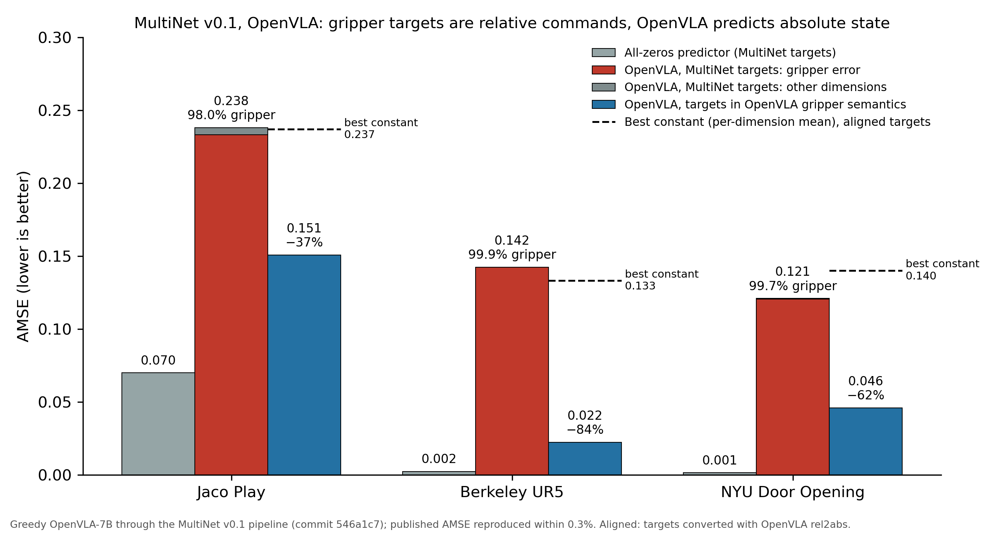
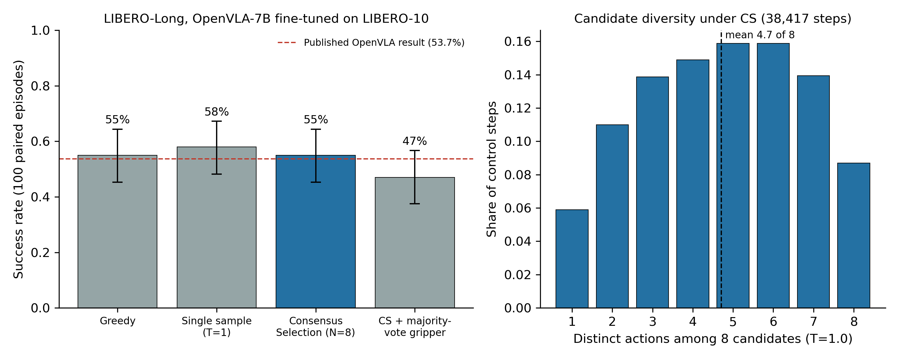

# Selection as a Reliability Layer for VLA Benchmarks

Evaluation code and verified results for two questions about vision-language-action (VLA) models,
using OpenVLA-7B as the test case:

* **(A) Test-time action selection.** Does Consensus Selection (CS), a verifier-free rule that
  executes the Gaussian-KDE mode among sampled candidate actions, make a frozen VLA more reliable
  on long-horizon closed-loop tasks (LIBERO-Long)?
* **(B) Action-space semantics audit of MultiNet v0.1.** Is the offline action-prediction metric of
  MultiNet v0.1 (commit [`546a1c7`](https://github.com/ManifoldRG/MultiNet/tree/546a1c77f9a4cc0544c5e4b41565949778d32441))
  measuring what it intends to measure for OpenVLA?

**TL;DR.**
(B) On 3 of MultiNet's 20 Open-X datasets (Jaco Play, Berkeley UR5, NYU Door Opening), MultiNet
compares OpenVLA's *absolute* gripper state with *relative* gripper commands. We reproduce the
published AMSE within 0.3%; the gripper accounts for 98.0-99.9% of it, an all-zeros predictor beats
the model, and aligning the two semantics lowers OpenVLA's AMSE by 37-87%.
(A) On LIBERO-Long, single-action CS over 8 samples matches greedy decoding (55% vs. 55%, 100
paired episodes) and does not beat a single sample (58%, p = 0.74), although the candidates are not
collapsed (4.7 distinct actions of 8 on average).

All numbers can be recomputed on a CPU in under 30 seconds from the
[Hugging Face artifacts](https://huggingface.co/hackhackhack66666/vla-test-time-and-multinet-audit).

## Artifacts (Hugging Face)

Per-step data behind every reported number, with a dataset card documenting the schema:
[**hackhackhack66666/vla-test-time-and-multinet-audit**](https://huggingface.co/hackhackhack66666/vla-test-time-and-multinet-audit)

| Artifact | Contents |
| --- | --- |
| [`multinet_audit/`](https://huggingface.co/hackhackhack66666/vla-test-time-and-multinet-audit/tree/main/multinet_audit) | Per-step OpenVLA predictions, original and aligned targets, observed gripper state for Jaco Play, Berkeley UR5 and NYU Door Opening (Parquet), target statistics for five datasets |
| [`multinet_audit/summary_metrics.json`](https://huggingface.co/hackhackhack66666/vla-test-time-and-multinet-audit/blob/main/multinet_audit/summary_metrics.json) | Every audit number in this README and in `docs/MULTINET_AUDIT.md` |
| [`libero_long_consensus/`](https://huggingface.co/hackhackhack66666/vla-test-time-and-multinet-audit/tree/main/libero_long_consensus) | Episode and step logs of the 400 LIBERO-Long rollouts (Parquet), paired statistics, candidate diversity |
| [`raw/`](https://huggingface.co/hackhackhack66666/vla-test-time-and-multinet-audit/tree/main/raw) | The same data as JSONL, in the layout read by the scripts in this repository |
| [`environment/`](https://huggingface.co/hackhackhack66666/vla-test-time-and-multinet-audit/tree/main/environment) | Pinned package lists and upstream revisions |
| [`MANIFEST.json`](https://huggingface.co/hackhackhack66666/vla-test-time-and-multinet-audit/blob/main/MANIFEST.json) | Size, row count and SHA-256 of every file |

The release is rebuilt from this repository with `scripts/build_hf_release.py` and uploaded with
`scripts/upload_to_hf.py`.

## (B) MultiNet v0.1 gripper-semantics audit



For Jaco Play, Berkeley UR5 and NYU Door Opening, the target gripper value is a change command
(+1 close, -1 open, 0 no change; continuous change for NYU Door). These are exactly the three
datasets whose OpenVLA data transform applies `rel2abs_gripper_actions`, so OpenVLA was trained to
output the absolute gripper state, which MultiNet's `convert_action` maps to +1 closed / -1 open.
The model therefore cannot express the "no change" class that makes up 75.7-98.5% of the targets.
The Berkeley UR5 dataset page documents the command semantics and recommends this conversion.
The other 17 datasets are not affected: 13 use absolute gripper semantics on both sides, 3 have no
gripper dimension, and `ucsd_pick_and_place` compares torque with state (noted in MultiNet's code).

| | Jaco Play | Berkeley UR5 | NYU Door Opening |
| --- | ---: | ---: | ---: |
| Test steps | 7,838 | 10,156 | 2,209 |
| Published OpenVLA AMSE | 0.2386 | 0.1424 | 0.1209 |
| Reproduced AMSE (MultiNet pipeline, greedy) | 0.2380 (-0.28%) | 0.1424 (+0.001%) | 0.1209 (-0.03%) |
| Gripper share of AMSE | 98.0% | 99.9% | 99.7% |
| All-zeros predictor (MultiNet targets) | 0.0699 | 0.0023 | 0.0013 |
| Fix 1: targets converted to states (`rel2abs`) | 0.1508 (-37%) | 0.0222 (-84%) | 0.0345 (-71%) |
| MSE-optimal constant on fix-1 targets | 0.2370 | 0.1332 | 0.1381 |
| Fix 2: model states converted to commands | 0.0709 (-70%) | 0.0190 (-87%) | n/a (no robot state) |

Fix 2 keeps MultiNet's targets and converts the predicted state into a command against the
observed gripper state (UR5 `gripper_is_closed`; Jaco finger joint, binarized at the midpoint of its
range). Pose dimensions contribute 0.05-2.0% of the AMSE; OpenVLA's pose error is below the
all-zeros predictor on all Jaco axes and 5 of 6 UR5 axes, but not on NYU Door (outside OpenVLA's
training mixture). Full 20-dataset table with code line references, both fixes, per-axis analysis
and limitations: [docs/MULTINET_AUDIT.md](docs/MULTINET_AUDIT.md).

## (A) Consensus Selection on LIBERO-Long



`openvla/openvla-7b-finetuned-libero-10`, OpenVLA's LIBERO evaluation protocol, the 10 LIBERO-10
tasks with initial states 0-9 (100 paired episodes per method; the same initial states for every
method). Candidates are sampled at temperature 1.0 over the full vocabulary.

| Method | Success | vs. greedy (paired) |
| --- | ---: | --- |
| Greedy decoding | 55% | |
| Single sample (T=1.0) | 58% | +3 pp, 95% CI [-8, +15], McNemar p = 0.74 |
| Consensus Selection, N=8 | 55% | 0 pp, 95% CI [-12, +12], p = 1.00 |
| CS + majority-vote gripper | 47% | -8 pp, 95% CI [-21, +5], p = 0.30 |

Greedy reproduces the published OpenVLA LIBERO-Long result (53.7%). Under CS the 8 candidates
contain 4.7 distinct actions on average and are identical in 5.9% of steps, so selection does
choose among different actions; it nevertheless does not change episode outcomes, and a single
sample is as good as greedy. The selector costs 0.37 ms per step against a policy call of about
580 ms. Decoupling the gripper from the selected candidate (majority vote) tends to hurt. The CS
gain reported in our AAMAS 2027 submission was obtained by selecting among sampled *action chunks*
of an autoregressive chunking policy; testing chunk-level selection on a stochastic chunking VLA is
the next step ([docs/RESEARCH_PLAN.md](docs/RESEARCH_PLAN.md)). The pre-registered protocol and its
ablation stages are in [docs/ONLINE_PLAN.md](docs/ONLINE_PLAN.md).

An earlier offline pilot of CS on Jaco Play (MultiNet metric) appeared negative (+2.26% AMSE vs.
greedy); with gripper targets in OpenVLA's semantics, CS and greedy are equal
([docs/OFFLINE_RESULTS.md](docs/OFFLINE_RESULTS.md)).

## Reproduce

**CPU, from the Hugging Face artifacts (under 30 seconds after a ~60 MB download):**

```sh
pip install huggingface_hub
huggingface-cli download hackhackhack66666/vla-test-time-and-multinet-audit --local-dir hf_artifacts
python experiments/offline/gripper_semantics.py hf_artifacts/raw/multinet_audit/*/predictions.jsonl
python experiments/online/summarize.py hf_artifacts/raw/libero_long_consensus
```

The first command prints every audit number above (both fixes, constants, per-axis errors); the
second prints the LIBERO success rates and paired McNemar tests. The dataset card shows a
short `datasets.load_dataset` check of the fix-1 and fix-2 reductions.

**CPU, from this repository only:**

```sh
python -m pip install -r requirements-audit.txt
python -m unittest discover -s tests
python scripts/verify_artifacts.py && python scripts/verify_baseline_results.py && python scripts/verify_cs_results.py
python experiments/offline/gripper_semantics.py
```

**GPU re-runs.** MultiNet pipeline on any dataset (about 16 GB GPU memory):

```sh
python experiments/offline/multinet_targets.py berkeley_autolab_ur5 --scratch SCRATCH --out runs/targets --expected-steps 10156
python experiments/offline/multinet_openvla_baseline.py berkeley_autolab_ur5 --expected-steps 10156 \
    --scratch SCRATCH --out runs/baseline --hf-home HF_CACHE
```

Closed-loop LIBERO-Long, in user space without root:

```sh
experiments/online/setup/bootstrap.sh && experiments/online/setup/setup_envs.sh vla && experiments/online/setup/setup_envs.sh libero
experiments/online/setup/serve.sh vla_libero &
experiments/online/setup/run_libero.sh runs/libero10 10 greedy sample cs cs_majgrip
python experiments/online/summarize.py runs/libero10
```

Details, pinned environments and expected outputs: [docs/REPRODUCIBILITY.md](docs/REPRODUCIBILITY.md)
and [environment/](environment/) (`pins.json` lists every upstream revision).

## Repository layout

| Path | Contents |
| --- | --- |
| `src/consensus_selection/` | Dependency-free CS and medoid selection on normalized action prefixes |
| `experiments/offline/` | MultiNet re-runs, target statistics, gripper-semantics audit, offline CS pilot |
| `experiments/online/` | OpenVLA sampling server, selection rules, LIBERO-10 and SIMPLER drivers, setup scripts |
| `kaggle/` | Original Kaggle bundles of the offline baseline and CS pilot |
| `scripts/` | Archive verification, Hugging Face release build and upload |
| `artifacts/` | Archived predictions, manifests and audits ([map](artifacts/README.md)) |
| `assets/` | 300 DPI figures |
| `docs/` | Audit, protocols, offline reports, reproduction guide, research plan |
| `environment/` | Pinned package lists and upstream revisions |
| `tests/` | Unit tests (`python -m unittest discover -s tests`) |

## Acknowledgements and citation

`experiments/online/robomonkey_compat.py` and `robomonkey_proposals.py` vendor helper code from
[RoboMonkey](https://github.com/robomonkey-vla/RoboMonkey) / openvla-mini (MIT License); the LIBERO
driver follows OpenVLA's `run_libero_eval.py` (MIT License). If you use these artifacts, please cite
the underlying benchmarks and model:

```bibtex
@article{guruprasad2024benchmarking,
  title   = {Benchmarking Vision, Language, \& Action Models on Robotic Learning Tasks},
  author  = {Guruprasad, Pranav and Sikka, Harshvardhan and Song, Jaewoo and Wang, Yangyue and Liang, Paul Pu},
  journal = {arXiv preprint arXiv:2411.05821},
  year    = {2024}
}
@article{kim2024openvla,
  title   = {OpenVLA: An Open-Source Vision-Language-Action Model},
  author  = {Kim, Moo Jin and Pertsch, Karl and Karamcheti, Siddharth and Xiao, Ted and Balakrishna, Ashwin and Nair, Suraj and Rafailov, Rafael and Foster, Ethan and Lam, Grace and Sanketi, Pannag and Vuong, Quan and Kollar, Thomas and Burchfiel, Benjamin and Tedrake, Russ and Sadigh, Dorsa and Levine, Sergey and Liang, Percy and Finn, Chelsea},
  journal = {arXiv preprint arXiv:2406.09246},
  year    = {2024}
}
@article{liu2023libero,
  title   = {LIBERO: Benchmarking Knowledge Transfer for Lifelong Robot Learning},
  author  = {Liu, Bo and Zhu, Yifeng and Gao, Chongkai and Feng, Yihao and Liu, Qiang and Zhu, Yuke and Stone, Peter},
  journal = {arXiv preprint arXiv:2306.03310},
  year    = {2023}
}
@article{oxe2023,
  title   = {Open X-Embodiment: Robotic Learning Datasets and RT-X Models},
  author  = {{Open X-Embodiment Collaboration}},
  journal = {arXiv preprint arXiv:2310.08864},
  year    = {2023}
}
```
