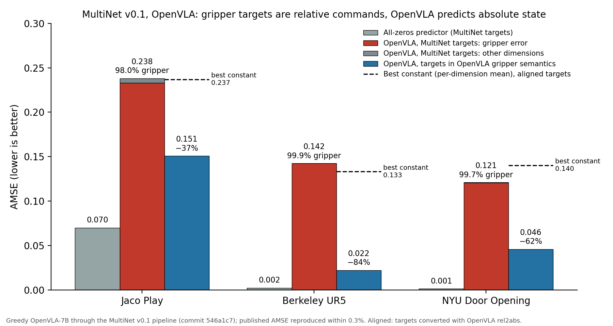

# Gripper-semantics audit of MultiNet v0.1 (OpenVLA, 20 Open-X datasets)

Audit date: 13 November 2026. Code references are to MultiNet commit
[`546a1c7`](https://github.com/ManifoldRG/MultiNet/tree/546a1c77f9a4cc0544c5e4b41565949778d32441),
the commit behind the published v0.1 OpenVLA results; the gripper conversions are unchanged on
`main` (checked 12 November 2026). OpenVLA's data pipeline is quoted from the copy vendored in
MultiNet (`src/eval/profiling/openvla/prismatic/...`), identical to `openvla/openvla`.

## Finding

For exactly three of the 20 datasets, MultiNet compares OpenVLA's **absolute** gripper output
(open / closed) with **relative** gripper targets (change of closedness, 0 = no change). These are
precisely the three datasets whose OpenVLA/Open-X data transform converts the raw gripper action
with `rel2abs_gripper_actions`. On all three, the gripper dimension accounts for over 98% of
OpenVLA's published AMSE and an all-zeros predictor scores better than the model. Aligning the two
semantics in either direction removes most of the error: converting targets to OpenVLA's states
lowers AMSE by 37-84%, and converting OpenVLA's states to commands against the observed gripper
state lowers it by 70-87% where a gripper state is observed.

Of the other 17 datasets, 13 use absolute gripper semantics on both sides, 3 have no gripper
dimension in the MultiNet target (`berkeley_cable_routing`, `toto`, `eth_agent_affordances`), and
`ucsd_pick_and_place` compares a gripper torque target with a state prediction, as MultiNet's own
code comment notes (`multinet_openvla_utils.py` L88: "ucsd_pick_and_place is using velocity and
torque for gripper not position"); that case is a different issue and is not counted here.

The relative semantics is documented by the dataset authors. The Berkeley UR5 dataset page
(<https://sites.google.com/view/berkeley-ur5/home>, linked from the TFDS feature description)
states: "delta_gripper_closed is ternary: 1 if gripper closing needs to be triggered from an open
state, -1 if gripper opening needs to be triggered from a closed state, 0 if no change. [...]
Preprocessing it to be the action state [...] could make the policy easier to learn", which is the
conversion OpenVLA applies. The UR5 TFDS feature description reads "1 if close gripper, -1 if open
gripper, 0 if no change".



## All 20 datasets

Sources: MultiNet target = `definitions/openx.py` (action-space description, line given);
`convert_action` = `src/eval/profiling/openvla/experiments/robot/multinet_openvla_utils.py`;
OpenVLA transform = `src/eval/profiling/openvla/prismatic/vla/datasets/rlds/oxe/transforms.py`.
"Mix" = in OpenVLA's training mixture `oxe_magic_soup_plus_minus`. Status: *verified* = MultiNet
pipeline re-run with OpenVLA and target statistics computed; *targets checked* = target
statistics computed, no model run; *code* = from code and descriptions only.

| Dataset | MultiNet target (gripper) | `convert_action` output (gripper) | OpenVLA `transforms.py` | Status |
| --- | --- | --- | --- | --- |
| `jaco_play` | Relative command {+1 close, -1 open, 0 no move} (L224); data: 75.7% zeros | `-discretize3(g)`, L45: +/-1 only (0 never output, 0/7838) | `rel2abs` (L173); mix | **Mismatch, verified** |
| `berkeley_cable_routing` | No gripper dimension (L230) | Reorder only, L54 | Inverted absolute (L187); mix | N/A, code |
| `nyu_door_opening_surprising_effectiveness` | "Closedness of the gripper" in [-1, 1] (L246); data: per-step change, 93.2% within +/-0.1, spikes on grasp | `-(2g-1)`, L57: continuous absolute closedness | `rel2abs` (L225); not in mix | **Mismatch, verified** |
| `viola` | Absolute {-1 open, +1 closed} (L258); data: only +/-1, open-closed-open | `-sign(2g-1)`, L61 | Clipped, inverted absolute (L242); mix | No mismatch, targets checked |
| `berkeley_autolab_ur5` | Relative command {+1 closing, -1 opening, 0 no change} (L272); data: 98.5% zeros | `-discretize3(2g-1)`, L65: +/-1 only (0/10156) | `rel2abs` (L269); mix | **Mismatch, verified** |
| `toto` | No gripper dimension (L282; boolean `open_gripper` is dropped by the float-only loader) | Reorder only, L71 | `open_gripper` cast (L283); mix | N/A, code |
| `columbia_cairlab_pusht_real` | Absolute {0 open, 1 closed} (L299); data: constant 0 (pusher) | `1 - binarize(g)`, L74 | None; not in mix | No mismatch, targets checked |
| `nyu_rot_dataset_converted_externally_to_rlds` | Absolute {0 closed, 1 open} (L311) | `binarize(g)`, L77 | Inverted absolute (L345); not in mix | No mismatch, code |
| `stanford_hydra_dataset_converted_externally_to_rlds` | Absolute {1 closed, 0 open} (L322) | `1 - binarize(g)`, L81 | Inverted absolute (L351); mix | No mismatch, code |
| `ucsd_kitchen_dataset_converted_externally_to_rlds` | Absolute {0 closed, 1 open} (L360) | `binarize(g)`, L85 | Gripper unchanged (L447); mix | No mismatch, code |
| `ucsd_pick_and_place_dataset_converted_externally_to_rlds` | Gripper torque, continuous (L372) | Raw value, L89 | Inverted, clipped (L453); not in mix | Different quantity (torque vs. state), noted in MultiNet's code comment; not this mismatch |
| `usc_cloth_sim_converted_externally_to_rlds` | Picker activation, >= 0.5 active (L390) | `1 - g`, L93 | None; not in mix | No mismatch, code |
| `utokyo_pr2_opening_fridge_converted_externally_to_rlds` | Absolute {0 closed, 1 open} (L398) | `binarize(g)`, L96 | None; not in mix | No mismatch, code |
| `utokyo_pr2_tabletop_manipulation_converted_externally_to_rlds` | Absolute {0 closed, 1 open} (L410) | `binarize(g)`, L96 | None; not in mix | No mismatch, code |
| `utokyo_xarm_pick_and_place_converted_externally_to_rlds` | Absolute {0 closed, 1 open} (L427) | `binarize(g)`, L104 | No gripper conversion (L526); not in mix | No mismatch, code |
| `stanford_mask_vit_converted_externally_to_rlds` | Absolute {+1 closed, -1 open} (L490) | `-sign(2g-1)`, L108 | No gripper conversion (L575); not in mix | No mismatch, code |
| `eth_agent_affordances` | No gripper dimension (velocities, L529) | First 6 dimensions, L113 | None; not in mix | N/A, code |
| `imperialcollege_sawyer_wrist_cam` | Absolute {1 open, 0 closed} (L539) | `binarize(g)`, L116 | None; not in mix | No mismatch, code |
| `conq_hose_manipulation` | Absolute {0 closed, 1 open} (L592) | `binarize(g)`, L119 | None; not in mix | No mismatch, code |
| `plex_robosuite` | Absolute {+1 closed, -1 open} (L624) | `-sign(2g-1)`, L123 | None; not in mix | No mismatch, code |

`discretize3` = `discretize_range_0_to_pos_1_gripper_action_to_3_values` (L14-37): -1 below 0.05,
+1 above 0.95, 0 in between; `binarize` = `binarize_gripper_action_for_0_1_range`;
`2g-1` = `normalize_gripper_action` (`robot_utils.py` L75-86).

## Verified numbers (MultiNet pipeline re-run, greedy OpenVLA, pinned versions)

| | Jaco Play | Berkeley UR5 | NYU Door Opening |
| --- | ---: | ---: | ---: |
| Test steps (= published) | 7838 | 10156 | 2209 |
| Our AMSE vs. published | 0.23799 vs. 0.23864 (-0.28%) | 0.142428 vs. 0.142427 (+0.001%) | 0.120908 vs. 0.120946 (-0.03%) |
| Hardware | 2x T4, FP16 | H100, BF16 | H100, BF16 |
| Gripper targets "no change" (abs < 0.1) | 75.7% | 98.5% | 93.2% |
| OpenVLA gripper outputs after `convert_action` | +/-1 only | +/-1 only | continuous (not trained on this dataset) |
| Gripper share of OpenVLA's AMSE | 98.0% | 99.9% | 99.7% |
| All-zeros predictor, MultiNet targets | 0.0699 | 0.0023 | 0.0013 |
| Fix 1: OpenVLA AMSE, targets converted to states | 0.1508 (-37%) | 0.0222 (-84%) | 0.0458 (-62%) |
| Best constant on the converted targets | 0.2592 | 0.1430 | 0.1431 |
| Fix 2: OpenVLA states converted to commands, MultiNet targets | 0.0709 (-70%) | 0.0190 (-87%) | not possible |
| Observed gripper state used by fix 2 | finger joint `joint_pos[6]` > 0.741 | `robot_state[13]` (`gripper_is_closed`) | none in observations |

Fix 1 converts each episode's gripper targets with the same `rel2abs_gripper_actions` rule
(threshold 0.1) and MultiNet's sign (+1 closed, -1 open). Fix 2 keeps MultiNet's targets and
converts the model's predicted state into a command against the observed gripper state,
a = clip(s_hat - s_obs, -1, 1). For UR5 the observed state is the documented `gripper_is_closed`
flag (it lags the command by a few steps, which costs fix 2 some error around each command). Jaco
has no binary gripper flag; the finger joint is binarized at the midpoint of its observed range
(0.741), and fix 2 gives 0.090 / 0.071 / 0.102 for thresholds 0.5 / 0.75 / 1.0. The
`end_effector_cartesian_pos[6]` field that OpenVLA reads as proprioceptive gripper state does not
respond to gripper commands in this split and was not used. NYU Door Opening observations contain
no robot state, so only fix 1 applies. All other dimensions are unchanged in both fixes.

GPT-4o and JAT cannot be re-scored: their per-step predictions are not available, although their
published Jaco AMSE (0.288, 1.237) is also above the all-zeros predictor (0.070).

The re-runs report `coverage_mismatch` only because MultiNet's loader splits each UR5, NYU Door and
PushT episode into two segments (208/104, 98/49, 28/14 segments/episodes); every test step is
evaluated exactly once and the step counts match the published ones.

## Reproduce

```sh
# CPU, from archived predictions: decomposition and re-scoring for all three datasets
python experiments/offline/gripper_semantics.py
python experiments/offline/plot_gripper_audit.py   # figure above (needs matplotlib)
# Target statistics of any split (downloads the official test split; CPU)
python experiments/offline/multinet_targets.py berkeley_autolab_ur5 --scratch DIR --out DIR --expected-steps 10156
# Model re-run with the archived baseline code (GPU, Python 3.11 pinned environment)
python experiments/offline/multinet_openvla_baseline.py berkeley_autolab_ur5 --expected-steps 10156 \
    --scratch DIR --out DIR --hf-home HF_CACHE
```

Archived outputs: `artifacts/baseline_audit/` (Jaco), `artifacts/multinet_audit/` (UR5, NYU Door,
target statistics for Jaco, UR5, NYU Door, VIOLA, PushT, and step-aligned observed gripper states
for Jaco and UR5 exported with `experiments/offline/multinet_gripper_state.py`).
